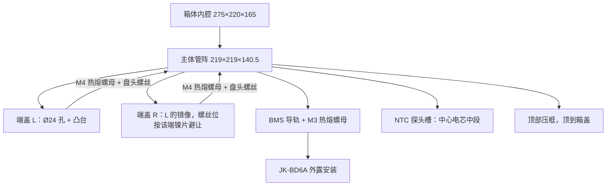

# 实施计划：32140 16S2P 电池支架 v2

> 旧文件 `电池支架-old.FCStd`、FreeCAD 中已打开的文档 `电池支架_old` 一律不改动。

## 问题说明
为 275（高）×220×165 的箱体（底面 220×165）重新设计一套 PETG 3D 打印的全包电池支架。装 32 只小鲁 32140（16S2P），单边 0.5 mm 装配公差，用在电动自行车上要求不晃动、受力合理。打印机最大 256×256×256。

## 需求汇总
| 项 | 值 |
|---|---|
| 电芯 | 32140，Ø33.2±0.2，长 140±0.3，32 只，16S2P |
| 排布 | 正方形网格，5 层×6 只（第 1–5 层），顶层（第 6 层）2 只放在第 5、6 列（靠右）；顶层空出的 4 个电芯位（第 1–4 列）放 BMS |
| 电芯孔 / 节距 | 孔 Ø33.6（参数，由试打块确定）/ 节距 35 mm（镍带孔距 34.5，每段累计偏差 ≤1 mm，不影响点焊） |
| 端面开孔 | Ø24，端盖挡板厚 1.5 mm（参数） |
| 箱体装配尺寸 | 宽 219（沿 220）、轴向总长 164（沿 165）、高 274.5（含压框）；每边 0.5 mm 公差 |
| 零件 | 主体管阵 ×1（两端开口）、左右镜像端盖 ×2（端盖 L、端盖 R）、顶部压框 ×1 |
| 端盖紧固 | 主体两端压 M4 热熔螺母（孔 Ø5.6×8），用 M4 盘头螺丝固定，螺丝头藏在端盖凸台高度以内 |
| BMS | JK-BD6AxxS-8PD，136×103×13.6，安装孔 4×Ø3.5，孔距 124（沿 136 方向）×94（沿 103 方向），用 M3 热熔螺母（孔 Ø4.0×6）。外露安装，便于散热 |
| 出线 | B+、B− 和采样线从两端出；镍片焊在端盖外侧 |
| 温度探头 | 1 根 NTC，贴在中心电芯侧面的中段，探头和线截面按 ≤5×5 mm 预留。如有第二根，用户自己用 Kapton 绝缘后贴在镍片上（B+ 焊点附近），模型不需要改 |

## 几何核算
截面坐标原点在左下角，X 沿 220，Y 向上，Z 沿电芯轴向。

- **截面宽度**：6×35 + 2×4.5 = **219**。电芯中心 X = 22、57、92、127、162、197；第 1–5 层中心 Y = 22、57、92、127、162；顶层 2 只的中心在 (162,197) 和 (197,197)。
- **壁厚**：孔间壁厚 1.4 mm，约 3 条线宽；孔到外表面最薄处 5.2 mm。
- **截面高度**：第 1–5 层顶面在 Y=184；顶层 2 只那块的外轮廓左侧壁约在 X≈143，顶面在 Y=219。
- **BMS 位置**：BMS 放在 X 4~140 范围内，用 2 根贯通全长的导轨托起（宽 10、高 7，中心在 X=10 和 X=134）。BMS 底面在 Y=191，顶面在 204.6，低于 219，侧面跟顶层电芯那块的外壁留约 3 mm。M3 孔在导轨顶面，轴向位于中点 ±47。
- **轴向尺寸**：电芯腔长 140.5（主体长度），两端端盖各 11.75（挡板 1.5 + 外凸台），总长 = **164**。端盖凸台宽 5 mm。
- **压框**：右侧压在顶层电芯那块的顶面（Y=219），左侧在 BMS 两头的轴向空余处伸下支腿，压到 Y=184。顶面到 Y=274.5。外形 ≤219×164，最大高度 90.5，打印放得下。
- **热熔螺母候选位**：只用两类位置。一是四孔之间的星形空区，到孔壁余量约 5.1 mm。二是外壁边上两孔之间的位置，离外表面约 7 mm，余量约 3.4 mm。具体位置要避开该端镍片覆盖的区域，所以两端的孔位可能不一样。

## 串联走向（蛇形，每层 3 组，每组是同一层里相邻的 2 只）
```
Y↑  第6层:                  [16]        ← B+（第5、6列），紧挨 BMS
    第5层: [13][14][15] →
    第4层: [12][11][10] ←
    第3层: [ 7][ 8][ 9] →
    第2层: [ 6][ 5][ 4] ←
    第1层: [ 1][ 2][ 3] →   ← B−（左下角，主线沿左侧往上走到 BMS）
```
组间连接在两端交替：1→2 在 A 端，2→3 在 B 端，依此类推。换层的连接是竖向的 2×2 块。B+ 和 B− 落在同一端。

## 零件关系


## 打印与力学要点
- **打印方向**：主体电芯轴向朝 Z 打，不需要支撑。横向的 M3 孔做成水滴形。端盖平板面贴热床打印。压框开口朝上打印。
- **减重和散热**：没有放螺母、没有探头槽的星形空区开 Ø8 贯通孔（参数，默认开）。
- **切片建议**：4 圈外壁，30% gyroid 填充，层高 0.2 mm。PETG 的玻璃化温度约 80 °C。
- **装配顺序**：压入热熔螺母 → 插入电芯 → 装入 NTC 探头 → 锁紧两端端盖 → 隔着 Ø24 孔点焊镍片 → 贴青稞纸绝缘 → 装 BMS → 装进箱体 → 放上压框 → 盖箱盖。

## 实现方式
- 参数化建模脚本 `battery_holder_v2.py`，所有尺寸集中在顶部的参数字典里。
- 通过 FreeCAD MCP 的 `execute_code` 运行脚本，生成新文档 `电池支架_v2`，保存为 `电池支架_v2.FCStd`。改参数后重跑脚本即可重新生成。
- 用 Part 工作台 Python API 建模。每个零件是独立对象；电芯、BMS、镍片、探头、箱体等假体放进单独的 Group，只作参考，不导出。
- 每个任务完成后跑校验（包围盒、干涉体积、最小壁厚、孔位余量），并截图确认。

## 待实测的假设（全部是参数）
- 镍带焊盘宽度按 ≤20 mm 处理。
- 电芯孔径 Ø33.6，热熔螺母孔 M4 Ø5.6、M3 Ø4.0，以试打块结果为准。
- 探头截面按 5×5 预留。

---

## 任务拆分

- [x] **Task 0：写入 plan.md**
- [x] **Task 1：参数表、脚本框架和公差试打块** —— 2×3 个 Ø33.4/33.6/33.8 孔（节距 35，高 15）+ M4/M3 螺母试孔 + 1.5 mm 挡边带 Ø24 孔 + 5.5×5 探头槽样段，导出 `STL/试打块.stl`。
- [x] **Task 2：主体管阵截面拉伸** —— 219×219×140.5，32 孔，星形减重孔；校验孔数、壁厚、包围盒，32 个电芯假体干涉 = 0。
- [x] **Task 3：串联分组和镍片占位** —— 16 组蛇形，两端镍片占位薄片；校验每组 2 只、正负极交替、B−/B+ 位置。
- [x] **Task 4：主体两端的 M4 热熔螺母孔** —— 每端 8–10 个，避开镍片与探头槽；余量 ≥3。
- [x] **Task 5：NTC 探头槽** —— 中心电芯 (92,92) 45° 方向，5.5×5，深 75，自动选择出线端；槽到其他孔余量 ≥2.5。
- [x] **Task 6：BMS 导轨和 M3 螺母孔** —— 2 根导轨 + 4 个水滴形 M3 孔 + BMS 假体；不干涉、间隙 ≥2、顶面低于 219。
- [x] **Task 7：左右镜像端盖** —— 1.5 挡板 + Ø24 孔 + 5×11.75 凸台 + 出线槽 + Ø10 螺丝凸台 + Ø4.5 通孔；出线端加探头 Ø6 过线孔；总长 164。
- [x] **Task 8：顶部压框** —— 顶到 274.5，镂空，避开 BMS 与线束区，打印尺寸 ≤256。
- [x] **Task 9：箱体总装校验、导出和文档** —— 箱体假体干涉/间隙校验，导出 STL/STEP，保存 FCStd，新建 `电池支架v2-需求与进展.md`。

## 执行记录
全部任务已完成，结果和偏差见 `电池支架v2-需求与进展.md`。主要偏差：BMS 改为 136 沿电芯轴向放置，因为插座边沿 220 方向放时离箱壁只有约 2 mm。
