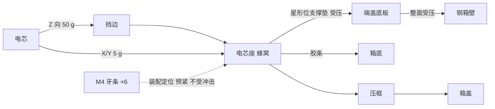

# 实施计划：32140 16S2P 电池支架 v3（两片电芯座 + 端盖顶箱壁）

> 这是最初的计划，第 3~7 节的尺寸已过时，以 `电池支架v3-需求与进展.md` 和第 9 节为准。v2 文件已删除，导出在 `STL/`、`STEP/`。

## 1. 问题
v2 主体是 140.5 长的整块管阵：
- 耗材多、死重大（实体约 2370 cm³）。
- 电芯被全包，散热差，高温大电流时 PETG 有软化风险。
- 侧向撞击时打印件可能被顶破，电芯碰到钢壳。
- 一字连接只有 1 条桥，2×2 连接有 2 条桥，过流密度不一致。
- 底部没有缓冲。

## 2. 需求（已与用户确认）
| 项 | 决定 |
|---|---|
| 电芯 | 小鲁 32140，Ø33.2±0.2 × 140±0.3，0.3 kg，32 只 16S2P，排布同 v2 |
| 箱体 | 内腔 275(Y)×220(X)×165(Z)。165（电芯轴向）朝车的左右，220 朝前后 |
| 绝缘 | 钢桶四个侧面、两个端面、底面贴青壳纸，厚度 0.x，`liner_t` 先按 0.5。箱盖内侧不贴 |
| 结构 | 两片电芯座，各深 24（含挡边），中间敞开。端盖平面顶箱壁，长螺杆串起端盖和电芯座 |
| 连接片 | 0.1 铜 + 0.1 镍，宽 20。层内 10 处用 4 只一排的直条；换层 5 处用 U 形（铜层用 0.1 铜箔剪成整片 U 形，再叠镍条）。不用 2×2 方形片，每处连接只有 1 条桥 |
| 电流 | 持续 30 A |
| 主线 | B− 用 12AWG 硅胶线，外径 4.5，截面 3.5 mm² |
| 底部缓冲 | 硅胶条 3×40，每端一条，长 218 |
| 侧面防护 | 只靠电芯座和青壳纸，不加打印侧板 |
| 载荷 | 侧向（Z）只考虑 1 m 摔车，取 50 g 一次性冲击（参考 UN38.3），允许轻微永久变形，不破裂，主拉应力 ≤ 30 MPa。前后（X）和竖直（Y）按 40 km/h 城市路面取 5 g，≤ 18 MPa；2 g ≤ 8 MPa。PETG 按 50 °C |
| 打印 | 256³ 打印机，单件 ≤ 251，PETG |

## 3. 几何核算
坐标同 v2：X 沿 220，Y 向上，Z 沿电芯轴向。原点在电芯座底面左下角、A 端电芯腔端面。

**X（220）**：220 − 2×0.5 纸 − 2×0.5 间隙 = **218**。`wall_out` 改为 4.0，外壁最薄 4.7，孔间壁 1.4。电芯中心 X = 21.5 + 35i，层中心 Y = 21.5 + 35j。H5 = 183，HT = 218，顶层块左壁 X = 140.5（壁厚 4.2）。

**Z（165）**：165 − 2×0.5 纸 − 2×0.5 间隙 = **163**。

| 段 | Z 范围（挡边 2.5 时） |
|---|---|
| 端盖 A（底板 2.5 + 支撑垫） | −11.25 ~ −2.5 |
| 挡边 A（Ø24 焊接孔，连接片焊在它外侧） | −2.5 ~ 0 |
| 电芯座 A 孔深 | 0 ~ 21.5 |
| 中间敞开（只有 6 根定位管） | 21.5 ~ 119 |
| 电芯座 B | 119 ~ 143 |
| 端盖 B | 143 ~ 151.75 |

端盖厚 `cap_t` = (163 − 140.5 − 2·`lip_t`)/2，挡边改薄时端盖自动变厚，外表面始终在 −11.25 / 151.75。

**Y（275）**：箱底钢面 Y = −3.5，青壳纸 −3.5 ~ −3.0，胶条 −3.0 ~ 0，支架底面 Y = 0。箱盖在 271.5，压框顶面 271.0，顶部间隙 0.5。

## 4. 传力路线

## 5. 连接片
- 连接片都沿层走，宽 20，相邻两层之间留一条 15 宽的空带，星形位在空带中心。
- 端盖支撑垫放在星形位：普通垫 Ø12，螺杆垫 Ø13，到连接片分别 1.5 和 1.0。
- U 形竖桥放在最外列（第 0 列 X 11.5~31.5，第 5 列 X 186.5~206.5），离最近的支撑垫 1.5。
- 连接表：

| 端 | 连接 |
|---|---|
| A | 1→2、5→6、7→8、11→12、13→14（直条）；3→4、9→10、15→16（U 形，竖桥在第 5 列） |
| B | B−（第 1 组）、B+（第 16 组）；2→3、4→5、8→9、10→11、14→15（直条）；6→7、12→13（U 形，竖桥在第 0 列） |

- 每处连接的桥：铜 2 mm² + 镍 2 mm²（约合 0.5 mm² 铜），合计约 2.5 mm² 铜当量。30 A 时约 12 A/mm²，每段桥约 0.1 W。

## 6. 零件
| 零件 | 说明 | 打印 |
|---|---|---|
| 电芯座 A / B | 挡边带 Ø24 孔，电芯孔 Ø33.6 深 21.5，星形位 Ø8 减重孔。6 根定位管 Ø14/Ø4.6，每片伸出 48.75，A 端带凸止口，B 端带凹止口。星形 (2,2) 开 Ø6 探头线孔。顶面 BMS 短导轨，M3 水滴孔 | 挡边朝下，约 218×218×75，无支撑 |
| 端盖 A / B | 2.5 底板，外周凸台宽 5，星形位支撑垫，螺杆位的 M4 螺母藏在外表面六角沉孔里（对边 7.3，深 3.5）。顶边开出线槽。B 端左侧开 B− 主线浅槽（1 深 6 宽） | 底板朝下 |
| 顶部压框 | 压在两片座和端盖的顶面，BMS 架在中间敞开段上方，前后墙给主线开缺口 | 顶环朝下 |

- 螺杆：M4 不锈钢牙条，位置在星形 (0,0)(4,0)(0,3)(4,3)(2,1)(4,4)，避开探头星形 (2,2)。长度约 162（两端螺母顶面比端盖外表面低 0.3，牙条不能凸出），按实际锯短。
- 定位管 Ø14 到电芯上限外径 Ø33.4 的间隙约 1.05。
- BMS 136 沿 Z，中心对齐 Z = 70.25，`bms_z0` = 2.25。M3 孔在 Z = 8.25 和 132.25，分别落在 A 座和 B 座上。插座端到压框内壁约 10.5。
- B− 主线：从 B 端左下角的 B− 连接片出发，沿左侧通道（X 5~11.5，这里没有连接片）上行，从端盖顶边的槽出来接到 BMS。
- 探头：贴在中心电芯 (2,2) 中段，用 Kapton 固定。线沿星形 (2,2) 的空隙走到 A 座的 Ø6 孔，A 端盖在 (2,2) 不放支撑垫。

## 7. 装配顺序
1. A 座挡边朝下放平，插入 32 只电芯（极性按连接表），把 B 座对准定位管止口扣上去。
2. 穿 6 根牙条，两端在挡边外侧用临时螺母（加垫片）夹紧。
3. 点焊：两端完全敞开。先焊整片 U 形铜层，再叠镍条。焊采样线，贴青稞纸。
4. 拆掉临时螺母，装上两块端盖，用螺母锁进六角沉孔。
5. 装 BMS，接 B− 主线和采样线。
6. 钢桶内贴青壳纸，底部两端各放一条胶条，装入支架，放上压框，盖上箱盖。

## 8. 任务
- [x] Task 0：写本文件
- [x] Task 1：`battery_holder_v3.py` 框架、连接片、箱体/青壳纸/胶条假体、试打块，以及对应的校验
- [x] Task 2：电芯座 A/B 和校验
- [x] Task 3：端盖 A/B 和校验
- [x] Task 4：BMS 导轨、线束预留区和校验
- [x] Task 5：胶条和压框，总装校验
- [x] Task 6：`fem_v3.py` 受力分析，挡边 1.2/1.5/2.0/2.5 对比，写 `FEA/受力分析报告_v3.md`
- [x] Task 7：导出 STL/STEP/FCStd，写 `电池支架v3-需求与进展.md`，更新 README

## 9. 执行中的修改（用户评审后）
上面第 5、6 节是最初的计划，下面这些改动以 `电池支架v3-需求与进展.md` 为准：
- 换层由 U 形改为 2×2 整块方片（用户自裁宽铜片），方片中心的星形位不放支撑垫和螺栓。
- 牙条 + 两端六角沉孔改为 M4 内六角长螺丝贯穿：头在端盖 A，尼龙防松螺母在端盖 B。螺栓位改为 (0,0)(2,0)(4,1)(0,2)(2,3)(4,3)。
- 挡边按 FEA 取 1.5，端盖厚 9.75。
- 取消 B− 浅槽和压框主线缺口；B+ 和总出线都从顶部出，压框顶环开口内留出线区。
- 端盖底板不开窗，边框开菱形通风窗。
- 串联顺序改为 B−、B+ 都在最上面一层（`P["series"]`），方片增至 9 块，螺栓位改为 (1,0)(3,0)(0,1)(3,2)(1,3)(4,3)。
- 箱体尺寸是外框（板厚 0.85），内腔 218.3×273.3×163.3。手工焊接不平整：两侧、顶部改为 3 mm 硅胶垫 + 0.5 空隙，前后每边 1.5。支架宽 214.7，端盖 6.1，取消边框通风窗。
- 螺栓改用 M4×150 不锯，头和尼龙螺母都没入端盖深沉孔，沉孔底 0.75。
- 端子片向上延伸成引出片，12AWG 在支架顶面以上锡焊；压框 B 端后墙在引出片处开缺口。
- v2 文件全部删除，导出目录改为 `STL/`、`STEP/`。
